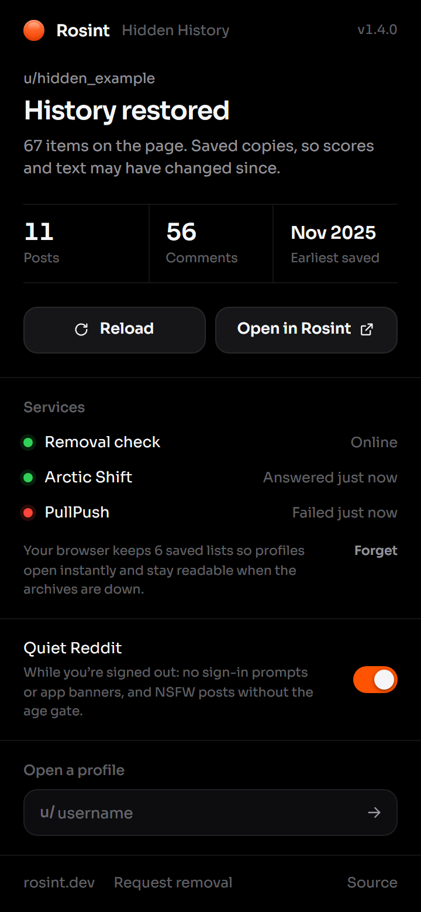

# Rosint Hidden History

**See what Reddit hides.** When an account hides its posts and comments,
Rosint fills its profile back in with the history that public archives saved.
The rows look like Reddit's own feed, follow light and dark mode, and sit
right where the history would be. And while you're signed out, Quiet Reddit
stops Reddit from nagging you to sign in or hiding NSFW posts behind its age
gate.

<p align="center">
  
</p>

- **Built into the profile.** No new tab or search box: open a profile that
  hides its history and the posts and comments appear there.
- **Honest about where rows come from.** A header says how many items were
  restored and whether they were checked against Reddit just now or are
  archived copies. Empty, restricted and failed lookups are explained instead
  of failing silently.
- **Respects removals.** Accounts that asked to be removed from Rosint are never
  shown. If that can't be confirmed, nothing is shown.
- **Fast on revisits.** Profiles you've opened before paint instantly from a
  copy kept in your browser, and stay readable when the archives are down.
- **Quiet Reddit.** Signed out, Reddit stops asking: no Google sign-in
  pop-up, no sign-up modal when you vote or after a while, no "open the app"
  banners, no "log in to confirm your age" gate. NSFW posts show without the
  blur, and adult communities that Reddit tells signed-out visitors "don't
  exist" are filled in from the public archive. **Log In** still works, and
  one switch in the popup turns it all off.
- **Private.** No accounts, no analytics, no tracking. See [PRIVACY.md](PRIVACY.md).

Works in Chrome, Edge, Brave and other Chromium browsers (111+), and Firefox
140+ on desktop and Android.

## Install

Store listings are on the way. Until then, install from source (no
dependencies needed to build):

```bash
git clone https://github.com/yoshik08/ROSINT-Extension.git
cd ROSINT-Extension
node extension/scripts/build.mjs
```

- **Chrome / Edge / Brave:** open `chrome://extensions`, enable Developer
  mode, click **Load unpacked** and select `extension/chrome`.
- **Firefox:** open `about:debugging#/runtime/this-firefox`, click **Load
  Temporary Add-on…** and select `extension/firefox/manifest.json`.

Prebuilt packages are attached to each
[release](https://github.com/yoshik08/ROSINT-Extension/releases).

## How it works

1. On a Reddit profile, the extension checks whether the account hides its
   history: Reddit's own notice, or an existing account with both listings
   empty. Public profiles are never touched.
2. The extension's background worker checks the account against Rosint's
   removal list, then asks the public archives
   ([Arctic Shift](https://arctic-shift.photon-reddit.com) and
   [PullPush](https://pullpush.io)) for one page of that account's posts and
   comments.
3. If you're signed in to Reddit, each row is checked against Reddit for its
   current text and score, and deleted or removed items are dropped. Signed
   out, Reddit refuses that check, so rows are shown as archived copies and
   labelled that way.
4. Scrolling loads the next page. Reddit's New/Hot/Top menu re-orders the
   rows.

Quiet Reddit runs on every Reddit page, before Reddit's own markup arrives.
It only acts when the page shows you're signed out (Reddit's Log In button,
its Google sign-in prompt or its age gate), and it never fetches anything to
do it: it removes what Reddit draws on top, answers the over-18 guard the way
you would, and closes sign-in prompts you didn't open yourself. When Reddit
refuses an NSFW community or post outright, the extension asks Arctic Shift
for that community's posts or that post's comments instead, with the same
removal list applied to every row.

The architecture, security model and test procedure are documented in
[extension/README.md](extension/README.md) and
[extension/RENDERING.md](extension/RENDERING.md).

## Permissions

| Permission | Why |
| --- | --- |
| `www.reddit.com` | Restores hidden profiles, reading Reddit's own data for the profile you're viewing, and keeps Reddit quiet while you're signed out. |
| `arctic-shift.photon-reddit.com`, `api.pullpush.io` | The public archives the history comes from. |
| `removal.rosint.dev` | Downloads the removal list so removed accounts are never shown. |
| `storage` | Keeps a copy of profiles you've already opened, on this device only. |

## Development

```bash
npm install
npm run check          # lint, all tests, build, web-ext lint
npm run ext:test       # unit + DOM tests only
```

Live checks against real reddit.com run headless and are documented in
[extension/README.md](extension/README.md#tests).

```
extension/shared/   extension source: content script, worker, popup, renderer
extension/chrome/   Chrome manifest (build output is written next to it)
extension/firefox/  Firefox manifest (build output is written next to it)
extension/scripts/  build, screenshots, live checks
extension/tests/    unit, DOM and end-to-end tests
src/                archive and restriction clients shared with rosint.dev
store/              store listing copy and screenshots
```

Contributions are welcome: see [CONTRIBUTING.md](CONTRIBUTING.md). Please
report security issues privately as described in [SECURITY.md](SECURITY.md).

## Removal

To keep your history out of Rosint, submit a request at
[removal.rosint.dev](https://removal.rosint.dev/). Once it's approved, the
website and this extension both stop showing it, including copies already
saved in browsers.

## License

[MIT](LICENSE). The Sora typeface is licensed under the
[SIL Open Font License](extension/shared/assets/fonts/OFL.txt).

Rosint is not affiliated with Reddit, Arctic Shift or PullPush.
